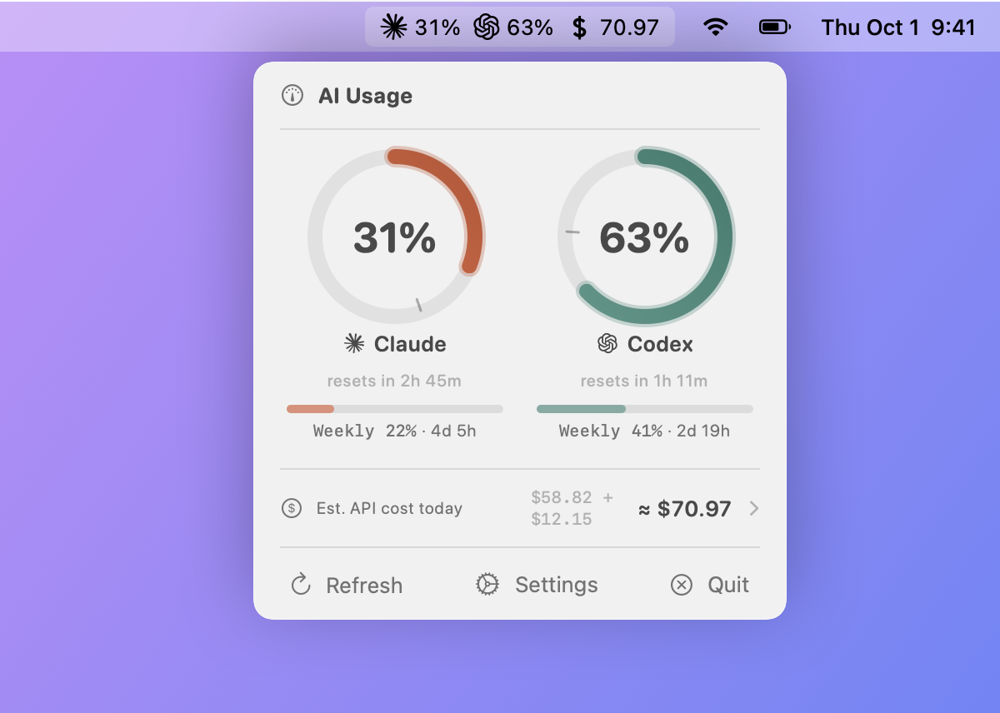
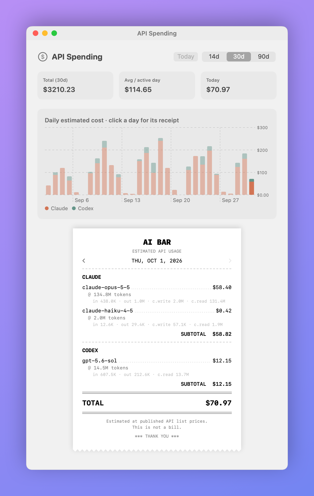

# AI Bar

A macOS menu bar app that tracks Claude and Codex (ChatGPT) token usage in real time.


<picture>
  <source media="(prefers-color-scheme: dark)" srcset="docs/popover-dark.png">
  
</picture>

<picture>
  <source media="(prefers-color-scheme: dark)" srcset="docs/spending-dark.png">
  
</picture>

## Features

- **Ring progress bars** showing 5-hour session usage for both Claude and Codex
- **Pacing indicator** — a tick mark on each ring showing where usage _should_ be for even consumption across the window
- **Weekly limits** — horizontal progress bar below each ring showing 7-day utilization
- **Auto-detection** — discovers which providers are installed, shows setup instructions for missing ones
- **Settings window** — enable/disable providers, adjust refresh interval (1m–15m)
- **Detail view** — click a ring to open a window with usage history charts (24h/7d/30d)
- **Live data** — polls the Anthropic and OpenAI OAuth APIs every 5 minutes (no manual input needed)
- **Usage history** — SQLite database recording every poll for trend analysis
- **Estimated API cost** (optional, enable in Settings) — what today's Claude Code and Codex usage would cost at published API list prices, shown in the menu bar and popover
- **Spending window** — click the cost row for a daily cost chart (14d/30d/90d) and a receipt-style, per-model breakdown for any day
- **Exponential backoff** on rate limits (429s)
- **No open ports** — reads credentials locally, no network listeners

## Requirements

- macOS 14.0+

At least one of:

- [Claude Code](https://claude.ai/code) logged in (`claude login`)
- [Codex](https://chatgpt.com) logged in (`codex login`)

The app auto-detects which providers are available and only shows those.

## Building it yourself

There are no prebuilt downloads: you build AI Bar from source. The only dev dependency is the Xcode Command Line Tools (`xcode-select --install`), which bring `swift` (5.9 or later) and `codesign`. You don't need an Apple Developer account.

```bash
git clone https://github.com/nicbet/ai-bar.git
cd ai-bar
make signing-cert   # 1. once: create your local signing certificate (see below)
make install        # 2. build the release app and install it in /Applications
```

The other tasks:

```bash
make bundle    # builds release binary + .app bundle
make run       # builds and launches
make snapshot  # renders the README screenshots in docs/ from sample data
```

### Signing certificate

AI Bar isn't signed with an Apple Developer ID. Without a certificate, `make bundle` signs it ad hoc, and an ad-hoc signature is different for every build, so macOS sees each rebuild as a new app. A self-signed certificate gives every build the same identity.

`make signing-cert` runs [`scripts/create-signing-cert.sh`](scripts/create-signing-cert.sh), which:

1. creates a self-signed certificate named "Local App Signing" with `openssl`, valid for 10 years and limited to code signing,
2. imports it with its private key into your login keychain, and lets `codesign` use the key,
3. trusts it for code signing only (macOS asks for your password).

`make bundle` checks for the identity with `security find-identity -v -p codesigning` and signs with it when it is there; otherwise it signs ad hoc and says so. Cappucino and Nocchi use the same "Local App Signing" identity, so you only create it once. To use a different name, pass it to both targets: `make signing-cert SIGNING_IDENTITY="My Signing"` and `make bundle SIGNING_IDENTITY="My Signing"`. On the first signed build, macOS may ask whether `codesign` may use the key: click **Always Allow**. To remove the certificate, delete "Local App Signing" (certificate and key) in Keychain Access.

The app isn't notarized. A copy you build yourself opens normally. If you copy it to another Mac, Gatekeeper blocks it the first time: click **Open Anyway** in System Settings → Privacy & Security, or run `xattr -dr com.apple.quarantine "/Applications/AI Bar.app"`.

## How It Works

### Data Sources

| Service | API Endpoint                                     | Auth                                                        |
| ------- | ------------------------------------------------ | ----------------------------------------------------------- |
| Claude  | `GET https://api.anthropic.com/api/oauth/usage`  | OAuth token from macOS Keychain (`Claude Code-credentials`) |
| Codex   | `GET https://chatgpt.com/backend-api/wham/usage` | Access token from `~/.codex/auth.json`                      |

Both APIs return utilization as a percentage and a reset timestamp. No token counting or file parsing needed.

### Cost Estimates

Cost estimates are computed locally from session transcripts (`~/.claude/projects/**/*.jsonl`, including subagents, and `~/.codex/sessions/`). Token counts are priced per model at the published API list prices, including cache writes/reads and fast mode. Daily totals are stored so history survives transcript cleanup; on first enable, up to 90 days are backfilled from existing transcripts. These are estimates of equivalent API cost, not a bill.

### Pacing

The tick mark on each ring shows where you'd be if you consumed your budget evenly across the window. If the filled arc is ahead of the tick, you're burning faster than sustainable pace.

### Data Storage

| File                          | Purpose                                                                                               |
| ----------------------------- | ----------------------------------------------------------------------------------------------------- |
| `~/.config/ai-bar/state.json` | Current usage state (persisted across restarts)                                                       |
| `~/.config/ai-bar/history.db` | SQLite database of usage snapshots (auto-pruned at 90 days) and daily cost estimates (kept ~400 days) |
| `~/.config/ai-bar/debug.log`  | Debug log for API errors                                                                              |

### Keychain Access

To ask Anthropic for your usage limits, AI Bar needs the OAuth access token Claude Code signed in with. Claude Code keeps that token in your login keychain, in an item named `Claude Code-credentials`, so AI Bar reads it from there. Codex keeps its token in `~/.codex/auth.json`, which AI Bar reads as a file; that needs no prompt.

AI Bar reads the item with the Security framework (`SecItemCopyMatching`). The item belongs to Claude Code, so the first time AI Bar reads it, macOS asks whether **AI Bar** may use it:

- **Always Allow** adds AI Bar, and only AI Bar, to the item's access list, so it isn't asked again. The grant is tied to AI Bar's code signature. With the [signing certificate](#signing-certificate), every build carries the same identity; with an ad-hoc build, expect the prompt again after each rebuild.
- **Allow** grants it once. AI Bar keeps the token in memory until it quits or the token expires, then asks again.
- **Deny** means AI Bar shows no Claude usage. Codex keeps working.

Checking whether you're logged in to Claude Code only looks up the item's name, which never prompts.

What AI Bar does with the tokens:

- The Claude token is sent only to `https://api.anthropic.com/api/oauth/usage`, and the Codex token only to `https://chatgpt.com/backend-api/wham/usage`, each as an `Authorization: Bearer` header. These are the only network requests AI Bar makes.
- Tokens stay in memory. They are not written to `state.json`, the history database or the debug log.

You don't have to take this on trust. All credential handling is in [`Sources/AIBar/APIClient.swift`](Sources/AIBar/APIClient.swift): `getClaudeToken()` reads the keychain (`claudeCredentialsExist()` only checks that the item is there), `readCodexToken()` reads `auth.json`, and `fetchClaudeUsage()` and `fetchCodexUsage()` are where the tokens are used. `grep -rn "https://" Sources` lists every URL in the app. You can also point your coding agent at the repository and ask it, for example: "Check whether this app sends credentials anywhere other than the two usage endpoints, or stores them."

## Usage

The menu bar shows icons and percentages for each active provider. Click to open the popover with ring displays, pacing indicators, and weekly limits. Click a ring to open a detail window with usage history charts. With estimated cost enabled, click the cost row to open the spending window; click a bar in the chart (or use the arrows) to see that day's receipt.

## License

MIT

## Trademarks

Claude and Claude Code are trademarks or registered trademarks of Anthropic, PBC. OpenAI, ChatGPT
and Codex are trademarks or registered trademarks of OpenAI. The Claude and ChatGPT icons in
`icons/` were redrawn by hand and are used only to identify each provider. AI Bar is an independent
project and is not affiliated with, endorsed by or sponsored by Anthropic or OpenAI.
