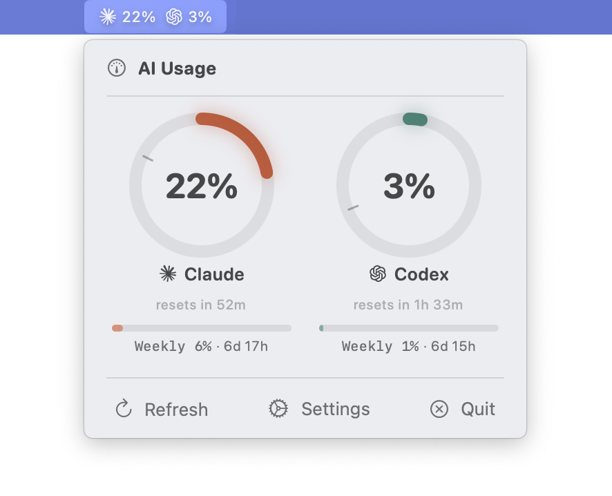

# AI Bar

A macOS menu bar app that tracks Claude and Codex (ChatGPT) token usage in real time.




## Features

- **Ring progress bars** showing 5-hour session usage for both Claude and Codex
- **Pacing indicator** — a tick mark on each ring showing where usage *should* be for even consumption across the window
- **Weekly limits** — horizontal progress bar below each ring showing 7-day utilization
- **Auto-detection** — discovers which providers are installed, shows setup instructions for missing ones
- **Settings window** — enable/disable providers, adjust refresh interval (1m–15m)
- **Detail view** — click a ring to open a window with usage history charts (24h/7d/30d)
- **Live data** — polls the Anthropic and OpenAI OAuth APIs every 5 minutes (no manual input needed)
- **Usage history** — SQLite database recording every poll for trend analysis
- **Exponential backoff** on rate limits (429s)
- **No open ports** — reads credentials locally, no network listeners

## Prerequisites

- macOS 14.0+
- Xcode Command Line Tools (`xcode-select --install`)

At least one of:
- [Claude Code](https://claude.ai/code) logged in (`claude login`)
- [Codex](https://chatgpt.com) logged in (`codex login`)

The app auto-detects which providers are available and only shows those.

## Build & Install

```bash
make bundle    # builds release binary + .app bundle
make install   # copies to /Applications
make run       # builds and launches
```

## How It Works

### Data Sources

| Service | API Endpoint | Auth |
|---------|-------------|------|
| Claude | `GET https://api.anthropic.com/api/oauth/usage` | OAuth token from macOS Keychain (`Claude Code-credentials`) |
| Codex | `GET https://chatgpt.com/backend-api/wham/usage` | Access token from `~/.codex/auth.json` |

Both APIs return utilization as a percentage and a reset timestamp. No token counting or file parsing needed.

### Pacing

The tick mark on each ring shows where you'd be if you consumed your budget evenly across the window. If the filled arc is ahead of the tick, you're burning faster than sustainable pace.

### Data Storage

| File | Purpose |
|------|---------|
| `~/.config/ai-bar/state.json` | Current usage state (persisted across restarts) |
| `~/.config/ai-bar/history.db` | SQLite database of usage snapshots (auto-pruned at 90 days) |
| `~/.config/ai-bar/debug.log` | Debug log for API errors |

### Keychain Access

On first launch, macOS may prompt you to allow AI Bar to read the Claude Code keychain entry. Click **"Always Allow"** to avoid repeated prompts.

## Usage

The menu bar shows icons and percentages for each active provider. Click to open the popover with ring displays, pacing indicators, and weekly limits. Click a ring to open a detail window with usage history charts.

## License

MIT
